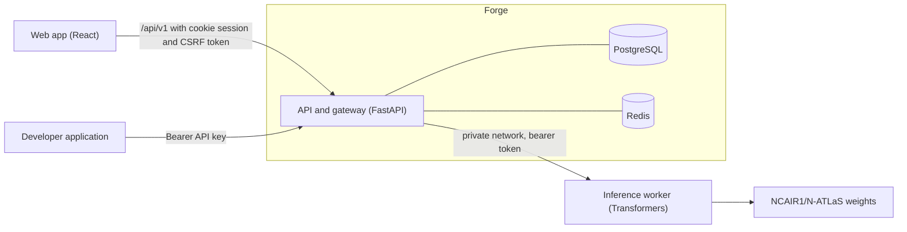

# Architecture

N-ATLAS Forge is developer infrastructure around the open N-ATLAS models. It sits between an application and the model and provides authentication, keys, limits, validation, logging and a stable API.

## Repository layout

| Path | Purpose |
| --- | --- |
| `backend/` | FastAPI application, SQLAlchemy models, Alembic migrations, tests |
| `frontend/` | React and TypeScript web app (Vite) |
| `inference/natlas-worker/` | Runs the official model with Transformers behind an authenticated API |
| `scripts/` | PowerShell tooling for setup, running, checking and packaging |
| `docs/` | Documentation |

## Backend layers

Dependencies point downwards only. Routers never talk to the database directly.

| Layer | Package | Responsibility |
| --- | --- | --- |
| HTTP | `app/api/v1` | Routing, request and response schemas, dependency wiring |
| Services | `app/services` | Business rules: auth, projects, API keys, gateway, dashboard, audit |
| Providers | `app/providers` | `ModelProvider` interface and the `NAtlasProvider` implementation |
| Data | `app/db`, `app/cache` | SQLAlchemy models and sessions, Redis client and rate limiter |
| Cross-cutting | `app/core`, `app/security`, `app/middleware` | Settings, errors, logging with redaction, token and password primitives, ASGI middleware |
| Extension points | `app/integrations`, `app/modules` | Contracts and loader for the Evaluation, Voice and MCP modules |

Middleware order, outermost first: request ID, security headers, access log with a safety net for unhandled errors, request body size limit, CORS (only when origins are configured).

## Request lifecycle for `POST /api/v1/chat`

1. The request receives an ID, a client IP is resolved, and the body size is checked.
2. The API key dependency verifies the Bearer key against its keyed hash and loads the project.
3. `GatewayService.chat` checks the `chat.create` scope, then the per-key rate limit.
4. Messages and parameters are validated, and the model is checked against the provider.
5. `NAtlasProvider` calls the inference worker. The destination is fixed by configuration and never influenced by user input.
6. A request log row and the daily usage counters are written, even for failures. Prompts and responses are not stored with it. The Evaluation Lab keeps its own dataset and result tables on purpose, see [evaluation-lab.md](evaluation-lab.md).
7. The response carries the request ID and rate limit headers.

## Providers

`ModelProvider` keeps the platform independent of how N-ATLAS is served. `NAtlasProvider` talks to the worker. The programme issues official N-ATLAS API credentials to shortlisted teams, but that interface is not published, so no client for it exists yet. When it is published it becomes a second provider and the gateway, SDKs and dashboards do not change. There is no mock or fallback provider in the runtime path, and Forge never substitutes another model.

## Data model

| Table | Purpose |
| --- | --- |
| `users`, `sessions` | Accounts and hashed session tokens |
| `projects`, `api_keys` | Projects and their keyed-hash API keys with scopes, expiry and rotation lineage |
| `requests`, `usage` | One row per admitted gateway request, and daily counters per project and model |
| `audit_logs` | Sign-ins, project changes and key events |
| `evaluations`, `evaluation_cases`, `evaluation_runs`, `evaluation_results`, `voice_requests`, `mcp_clients`, `system_settings` | Reserved for the extension modules. Names are fixed. |

All primary keys are UUIDs except the composite key of `usage`. Constraint and index names follow a naming convention, and `alembic check` verifies that models and migrations agree.

## Trust boundaries

- The browser authenticates with an HTTP-only session cookie. Every state-changing request needs a CSRF token bound to the session and an allowed Origin.
- Developer applications authenticate with a Bearer API key. Browsers never attach it automatically, so CSRF does not apply. A session cookie never authorises the gateway.
- The inference worker is reachable only with a shared token and should listen on a private address.
- PostgreSQL and Redis are not exposed publicly.
