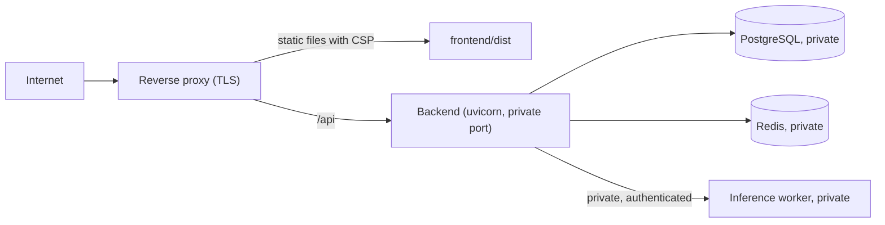

# Deployment

**Status: no deployment has been performed or verified.** This page lists what a deployment needs. Before changing any live environment, inspect its current configuration first: firewall rules, exposed ports, service bindings, reverse proxy, TLS, database and Redis exposure, file permissions, service accounts, secrets, backups and monitoring. Do not assume anything about it and do not modify it blindly.

## Topology



Only the reverse proxy listens publicly. PostgreSQL, Redis, the backend and the worker bind to loopback or a private network.

## Backend

- Provide real environment variables, not a `.env` file. Required: `APP_ENV=production`, `DATABASE_URL`, `REDIS_URL`, `SECRET_KEY`, `API_KEY_PEPPER`, `PUBLIC_BASE_URL` (https), `COOKIE_SECURE=true`.
- Production validation refuses to start with placeholder or short secrets, insecure cookies, an http `PUBLIC_BASE_URL`, or a plaintext remote worker URL.
- Set `ENABLE_API_DOCS=false`. Set `TRUSTED_PROXY_COUNT` to the number of proxies you control, and make sure the proxy overwrites `X-Forwarded-For`.
- Run `alembic upgrade head` as a release step before starting the new version. Use a database role with only the privileges it needs. Keep `API_KEY_PEPPER` and `SECRET_KEY` stable, because changing the pepper invalidates every API key.
- Start with `uvicorn app.main:create_app --factory --host 127.0.0.1 --port 8000` behind a process supervisor. Probe `GET /api/v1/health/live` and `GET /api/v1/health/ready`.

## Web app

Build with `npm ci` and `npm run build`, then serve `frontend/dist` with a single-page-app fallback to `index.html`. The build uses no inline scripts, so a strict policy works. The proxy should send, at least:

```
Content-Security-Policy: default-src 'self'; script-src 'self'; style-src 'self'; img-src 'self' data:; font-src 'self'; connect-src 'self'; frame-ancestors 'none'; base-uri 'self'; form-action 'self'
```

Verify it against the real build before relying on it. The proxy also sets HSTS for the web app. The API sets its own headers for `/api` responses.

## Inference worker

Run it on a machine with enough memory (see [n-atlas-integration.md](n-atlas-integration.md)), bound to a private address, with `NATLAS_WORKER_TOKEN` set and the same value in the gateway's `NATLAS_INFERENCE_TOKEN`. Use https between hosts, or set `NATLAS_ALLOW_PLAINTEXT_REMOTE=true` only on a private network you control.

## Not yet prepared

Containers, a CI deploy job, backups and restore tests, log shipping and monitoring. These belong to the hardening stage.
