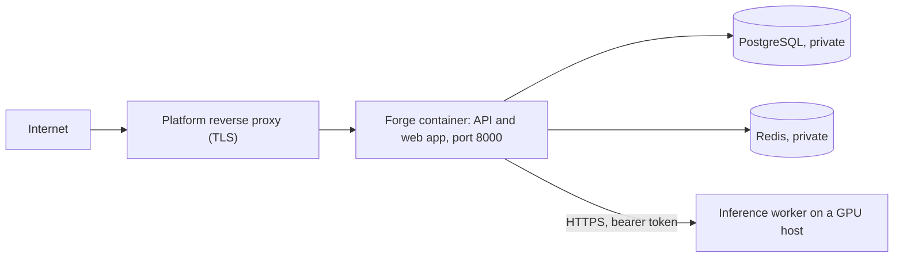

# Deployment

**Status: deployed.** The image was built from `main` and run on a container platform on 14 October 2026, and the smoke test passed against the live address. [status.md](status.md) records the evidence.

Before changing any live environment, inspect its current configuration: firewall rules, exposed ports, service bindings, reverse proxy, TLS, database and Redis exposure, file permissions, secrets, backups and monitoring. Do not assume any of them, and never modify a live server blindly.

## What gets deployed

One container serves the API and the web app on port 8000. PostgreSQL, Redis and the model worker are separate.



- The image is defined by `Dockerfile` at the repository root. Stage 1 builds the web app with `npm ci` and `npm run build`. Stage 2 installs the backend, copies the build and runs as a non-root user.
- `docker/entrypoint.sh` runs `alembic upgrade head` and then starts uvicorn. A failed migration stops the container, so a half-migrated version never serves traffic.
- The API and the web app share one origin, so cookies are first-party and no CORS setup is needed. The web app answers only paths that no API route matched. Unknown `/api/...` paths stay JSON 404 responses and a missing asset is a real 404.
- HTML responses carry a strict Content-Security-Policy. Hashed files under `/assets` are cached for a year and revalidated files are not.
- The Docker health check calls `/api/v1/health/live`, which does not depend on PostgreSQL, Redis or the model worker. `/api/v1/health/ready` reports all three.

## Environment variables

Provide these as real environment variables on the platform. Never commit them. The full list with defaults is in [environment-variables.md](environment-variables.md).

| Variable | Value | Notes |
| --- | --- | --- |
| `DATABASE_URL` | From the platform's database page | `postgresql://` and `postgres://` are rewritten for the asyncpg driver. URL-encode special characters in the password. |
| `REDIS_URL` | From the platform's Redis page | For example `redis://:PASSWORD@HOST:6379/0`. Rate limiting needs Redis. With Redis down, requests are refused unless `RATE_LIMIT_FAIL_OPEN=true`. |
| `SECRET_KEY` | 64 random characters | At least 32. Placeholders are rejected in production. |
| `API_KEY_PEPPER` | 64 random characters | At least 32. Changing it later invalidates every API key. |
| `COOKIE_SECURE` | `true` | Required in production. |
| `PUBLIC_BASE_URL` | `https://` plus the public address | Exactly what users type, with no path. It drives the Origin check, so a wrong value makes sign-in fail with `origin_not_allowed`. |
| `TRUSTED_PROXY_COUNT` | `1` | The number of proxies you control in front of the container that append to `X-Forwarded-For`. Count every hop: a CDN in front of the platform's proxy makes it `2`. Use `0` when there is none. |
| `REGISTRATION_ENABLED` | `true` or `false` | Close sign-ups with `false`. |
| `NATLAS_INFERENCE_URL` | `https://` address of the worker | Optional until a worker exists. Set together with the token. |
| `NATLAS_INFERENCE_TOKEN` | Same value as the worker's `NATLAS_WORKER_TOKEN` | Set both or neither. |

The image already sets `APP_ENV=production`, `LOG_FORMAT=json`, `ENABLE_API_DOCS=false`, `PORT=8000` and `FRONTEND_DIST_DIR=/app/frontend-dist`.

`.\scripts\prod-env.ps1` generates the two secrets, copies them to the clipboard one at a time without printing them, and reads the inference token from your local `.env`.

## First deployment

1. Provision PostgreSQL and Redis that are not reachable from the internet.
2. Generate the secrets and store `SECRET_KEY` and `API_KEY_PEPPER` in a password manager.
3. Create the service from the repository root on the `main` branch. The platform builds the `Dockerfile` and reads port 8000 from `EXPOSE`.
4. Set the variables above and deploy. A healthy start logs, in this order: `[entrypoint] applying database migrations`, the Alembic lines for revisions `0001` and `0002`, `[entrypoint] starting the server on port 8000`, `spa.enabled`, `app.starting`, `startup.database_reachable`, `startup.redis_reachable` and `startup.provider_status`. `startup.database_unreachable` or `startup.redis_unreachable` names the service that failed.
5. If you did not know the public address in advance, set `PUBLIC_BASE_URL` to it now and deploy again. A custom domain avoids this second pass.
6. Verify from your PC:

   ```powershell
   Invoke-RestMethod https://YOUR-ADDRESS/api/v1/health/ready
   .\scripts\smoke-day1.ps1 -BaseUrl https://YOUR-ADDRESS -Origin https://YOUR-ADDRESS
   ```

   The readiness response must show `ok` for the database and Redis. The provider is `ok` once a worker is connected and `degraded` before that. The smoke test creates a throwaway account and project and archives the project afterwards. The account stays in the database.

## Operating

| Task | How |
| --- | --- |
| Release | Merge to `main`, then deploy. Every deploy rebuilds the image and runs pending migrations on start. |
| Back up | Take a `pg_dump --format=custom` before any release that adds a migration. Migrations only move forward. |
| Rotate `SECRET_KEY` | Change it and redeploy. Signed CSRF tokens are replaced on the next page load. |
| Rotate `API_KEY_PEPPER` | Do not, unless you intend to invalidate every API key. |
| Change the worker address | Update `NATLAS_INFERENCE_URL`, then redeploy or restart. See [model-hosting.md](model-hosting.md). |
| Skip migrations once | Set `FORGE_SKIP_MIGRATIONS=true` for that start only. |
| Processes | The container runs one uvicorn process. Review in-process state before adding workers. |

## Troubleshooting

| Symptom | Likely cause | Fix |
| --- | --- | --- |
| The container exits at once and the log names a setting | A required variable is missing, a placeholder, or too short | Fix the variable. Validation messages never print the value. |
| Alembic reports `password authentication failed` or `could not translate host name` | Wrong `DATABASE_URL`, or the internal host name is not reachable from the container | Use the connection string from the database page. If the internal name does not resolve, use the external form. |
| `startup.redis_unreachable`, or sign-in returns 503 `rate_limiter_unavailable` | Wrong or unreachable `REDIS_URL` | Fix the URL. Test it from another container on the same network. |
| Register or sign-in fails with `origin_not_allowed` | `PUBLIC_BASE_URL` differs from the address in the browser (scheme, host or port) | Set it to the exact address and redeploy. |
| Rate limits and audit rows show the proxy address for every user | `TRUSTED_PROXY_COUNT` is `0` behind a proxy | Set it to the number of proxies that append to `X-Forwarded-For`. |
| The page is blank and the browser console reports a Content-Security-Policy violation | Something loads from another origin | Copy the first console message and fix the source. The policy is in `backend/app/web/spa.py`. |
| The platform never marks the container healthy | The process is not listening on 8000, or startup failed | Read the container log. The health check waits up to 60 seconds before it counts failures. |
| 502 from the proxy | Container not running, or the platform's port does not match `EXPOSE 8000` | Check the container and the port. |
| Chat returns `provider_unavailable` or the dashboard shows the model as unavailable | The worker is stopped or its address changed | Start the worker, update `NATLAS_INFERENCE_URL`, redeploy. |
| A long generation fails with a 504 from the proxy although the worker is healthy | Proxies commonly stop waiting after 60 seconds, which is shorter than `NATLAS_REQUEST_TIMEOUT_SECONDS` | Lower `max_tokens` in the request, or raise the proxy's read timeout. |

## Security notes

- TLS ends at the platform proxy. The application sends HSTS in production, secure and HTTP-only cookies, and the headers listed in [security.md](security.md).
- PostgreSQL and Redis must not be published to the internet. Use the platform's private network, or an address that only the container can reach.
- The container runs as an unprivileged user and holds no secrets in the image or in git.
- No security certification is claimed. See [security.md](security.md) for what is implemented and what is not.

## Not yet prepared

A CI deploy job, scheduled database backups with restore tests, log shipping, uptime monitoring and a persistent model host. These belong to the hardening stage.
