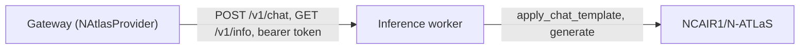

# N-ATLAS integration

This page records what was verified from official sources, how Forge integrates with N-ATLAS, and exactly what is still missing. Nothing here is assumed.

## Sources

- Model cards under the NCAIR organisation on Hugging Face: <https://huggingface.co/NCAIR1> (model card version 1.0, September 2025).
- National AI Innovation Challenge 2026 page: <https://ncair.nitda.gov.ng/naic/>.

Read both again before relying on dates or terms, because they can change.

## Official models

| Model | Kind | Verified facts |
| --- | --- | --- |
| `NCAIR1/N-ATLaS` | Text generation | Fine-tuned from Llama-3 8B (`LlamaForCausalLM`), 8 billion parameters. English, Hausa, Igbo and Yoruba. The card lists a context length of 8,092 tokens and 131,072 maximum position embeddings. Gated repository. The page states that no inference provider hosts it. |
| `NCAIR1/NigerianAccentedEnglish` | Speech recognition | Whisper Small fine-tune, 244M parameters. 16 kHz audio recommended, 30 seconds maximum per inference. Gated. |
| `NCAIR1/Yoruba-ASR` | Speech recognition | Whisper Small fine-tune, 244M parameters. 16 kHz audio recommended, 30 seconds maximum per inference. Gated. |
| `NCAIR1/Hausa-ASR` | Speech recognition | Listed in the organisation. Architecture and attribution text were **not** verified in this build. |
| `NCAIR1/Igbo-ASR` | Speech recognition | Listed in the organisation. Architecture and attribution text were **not** verified in this build. |

The official usage is the Transformers library with the model's chat template rendered with `date_string`. The example uses a temperature of 0.1 and a repetition penalty of 1.12, and Forge uses those as its defaults.

## What the challenge page says about access

- N-ATLAS API credentials and compute credits are provided to **shortlisted** teams. The interface of that API is not published, so Forge does not contain a client for it.
- A Developer Infrastructure solution must integrate directly with N-ATLAS. Wrapping another general-purpose model does not qualify. Forge therefore has no fallback provider and never substitutes another model.
- Developer Infrastructure needs at least two external beta testers.

## How Forge integrates



- `backend/app/providers/natlas.py` is the only code that talks to the worker. The URL comes from configuration, redirects are disabled, proxy environment variables are ignored, and every response field is validated.
- `inference/natlas-worker` loads the model with Transformers in a background thread, serialises generation, bounds the queue, enforces the context limit with exact token counts, and never logs prompts or generated text.
- If the worker is missing, unreachable, still loading or failed, the gateway returns a structured error such as `provider_not_configured`. It never returns invented text.

### Parameter mapping

| Gateway field | Worker field | Effect |
| --- | --- | --- |
| `max_tokens` | `max_new_tokens` | Upper bound on generated tokens |
| `temperature` above 0 | `do_sample=True`, `temperature`, `top_p` | Sampling |
| `temperature` equal to 0 | `do_sample=False` | Greedy decoding, `top_p` ignored |
| `repetition_penalty` | `repetition_penalty` | Passed through |
| none | `max_time` | Generation stops at `NATLAS_WORKER_MAX_GENERATION_SECONDS` and reports `finish_reason` `length` |

`finish_reason` is `stop` when the last generated token is an end-of-turn token and `length` otherwise. `prompt_tokens` counts the prompt after templating. `completion_tokens` excludes the end-of-turn token.

## What you must provide

| Requirement | Detail |
| --- | --- |
| Hugging Face access | An account that accepted the conditions on the model page, and a read token set as `HF_TOKEN` for the worker |
| Compute | About 16 GB for the 16-bit weights alone (8 billion parameters at 2 bytes each). A GPU with more memory than that is the practical choice. CPU inference is possible and very slow. |
| PyTorch | Installed by you for your hardware, then `requirements-model.txt` |
| Official API credentials | Only if you are shortlisted. They need a new provider implementation once the interface is published. |

## Run it

```powershell
.\scripts\setup-local.ps1 -WithWorker
# install PyTorch for your hardware, then the model libraries (setup prints the exact commands)
.\scripts\connect-worker.ps1 -Url http://127.0.0.1:8081
.\scripts\dev.ps1 -WithWorker
.\scripts\smoke-day1.ps1
```

`smoke-day1.ps1` prints `N-ATLAS inference: VERIFIED` only when the real model returned generated text. Otherwise it prints `NOT CONNECTED` together with the structured error the gateway produced.

### No GPU on your machine

See [gpu-host-notebook.md](gpu-host-notebook.md) to run the same worker on a free dual-T4 notebook and connect Forge to it with `connect-worker.ps1 -Url`.

## Not implemented yet

Streaming responses, speech recognition, an official N-ATLAS API client, and any quantised or community variants. Community variants are unofficial and are deliberately not used.

## Licence

See [licensing-and-attribution.md](licensing-and-attribution.md).
